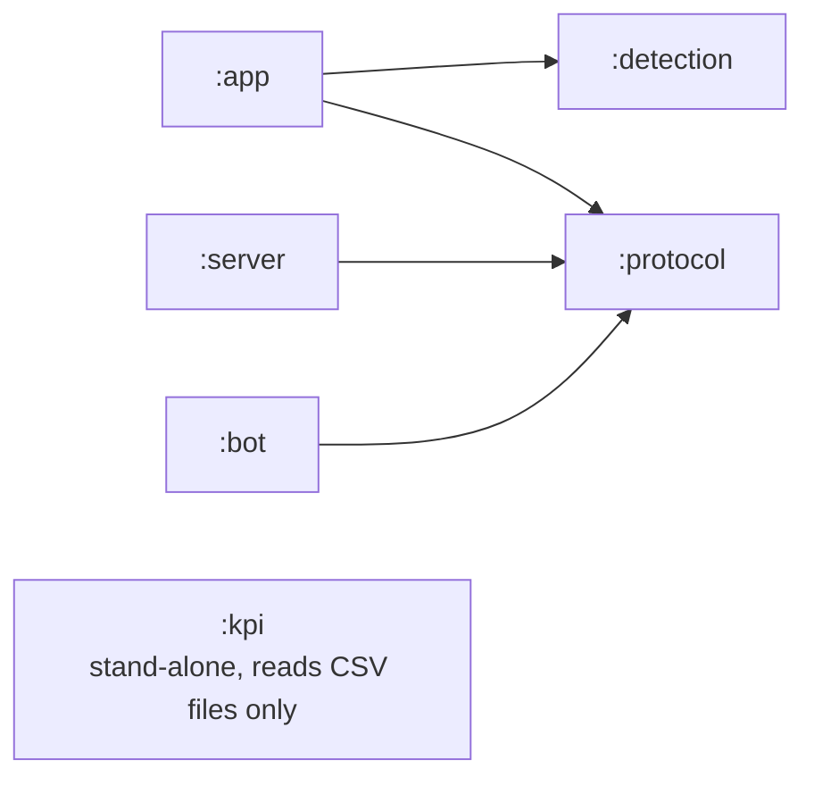
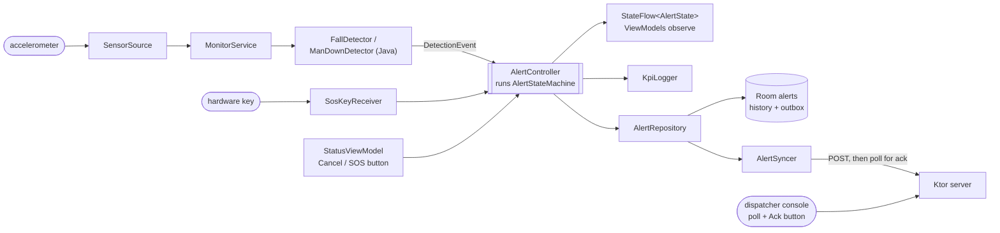
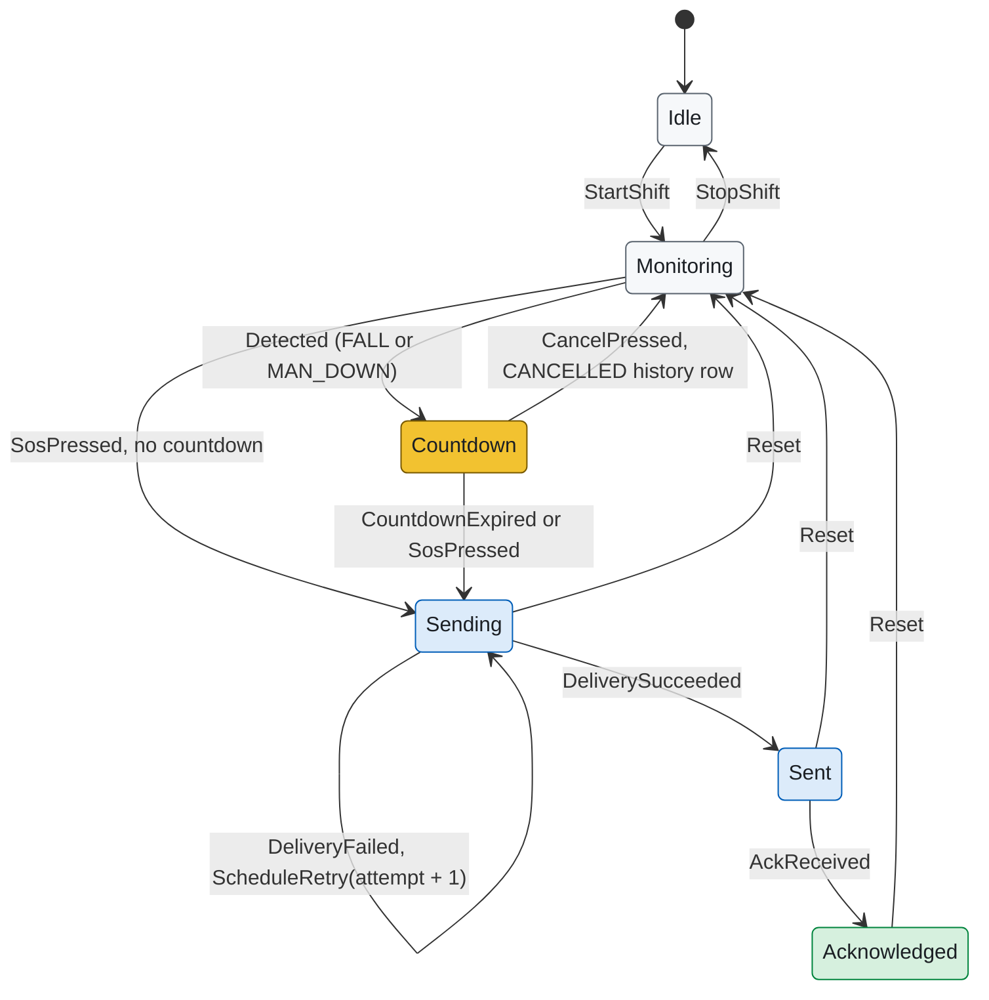

# SafeSignal — Architecture

Short version: `ARCHITECTURE-ESSENTIALS.md`. Data shapes: `Data.md`.

## Modules

| Module | Language | Type | Contents |
|---|---|---|---|
| `:detection` | Java only | pure JVM | `FallDetector`, `ManDownDetector`, `AccelSample`, `DetectorConfig`, `DetectionEvent` |
| `:protocol` | Kotlin | pure JVM | `AlertMessage`, `AlertRecord`, `AckRequest`, `AlertStateMachine`, `RetryPolicy`, `AlertApi` (Ktor client wrapper, engine injected) |
| `:server` | Kotlin | Ktor JVM app | routes, `AlertStore`, static dispatcher console, server KPI CSV |
| `:bot` | Kotlin | JVM CLI | fake worker that sends alerts through `AlertApi` |
| `:kpi` | Kotlin | JVM CLI | reads KPI CSVs, writes `summary.md` / `summary.csv` |
| `:app` | Kotlin | Android app | UI, ViewModels, repository, Room, foreground service, device admin |
| `:overlay` | XML only | Android RRO APK | Runtime Resource Overlay (no code) |

`:app` and `:overlay` join the build at M5.

### Dependency direction



`:detection` and `:protocol` depend on nothing Android, so they are tested on the JVM in seconds.

## App layers (`com.safesignal.app`)

| Layer | Classes |
|---|---|
| View (Compose) | `MainActivity`, `StatusScreen`, `HistoryScreen` |
| ViewModel | `StatusViewModel`, `HistoryViewModel` — each exposes one `StateFlow<UiState>` |
| Repository | `AlertRepository` (Room + `AlertApi`), `SettingsRepository` |
| Domain glue | `AlertController` (`@Singleton`, owns `StateFlow<AlertState>`, runs state-machine effects), `AlertSyncer` (retry loop + ack polling) |
| Data sources | `SensorSource`, `LocationSource`, `BatterySource` interfaces with Android and fake/replay implementations; `AlertDao`, `SafeSignalDatabase` |
| Service | `MonitorService` (foreground, type `location`, partial wake lock), `SosKeyReceiver` |
| Admin | `SafeSignalAdminReceiver`, `KioskManager` |
| Other | `KpiLogger`, Hilt modules in `di/` |

Every data source is an interface bound by Hilt, so tests swap in fakes.

## Data flow



## Alert state machine

`AlertStateMachine.transition(state, event) → (newState, effects)` is a pure function in `:protocol`. No I/O, so each transition is one unit test.



Colours match the charts in `docs/images/`: yellow can still be cancelled, blue is on its way to the server, green has been acknowledged by a dispatcher.

- One active alert at a time: detections and SOS presses are ignored in `Sending`, `Sent`, `Acknowledged`.
- `StopShift` is ignored while an alert is active.
- Effects: `StartCountdown`, `StopCountdown`, `PersistAlert`, `SendAlert`, `ScheduleRetry`, `StartAckPolling`, `LogKpi`.

## Key decisions

| Decision | Why | Trade-off |
|---|---|---|
| Detection in a Java module | Shows Java and interop; no Android types needed | Two languages in one repo |
| State machine as a pure function | Every row testable without Android | Effects must be interpreted by `AlertController` |
| Retry loop inside the foreground service, not WorkManager | Fewer parts; testable with a fake clock | No retry after process death beyond the Room outbox being re-read on restart |
| Ack by polling every 3 s | No FCM on AOSP | Up to 3 s delay, extra requests |
| Client-generated `alertId` | Retried POST is idempotent | Server must de-duplicate |
| `LocationManager`, not Fused Location | No Play services on the AOSP image | Less accurate provider selection |

## Folder layout

```
detection/  protocol/  server/  bot/  kpi/     JVM modules
app/  overlay/                                 Android modules (from M5)
aosp/                                          AOSP customization + verify scripts
scripts/                                       SDK setup, emulator, e2e, KPI, diagnostics
docs/agile/  docs/debugging/  docs/evidence/   process, case studies, saved output
gradle/libs.versions.toml                      every version in one place
```
