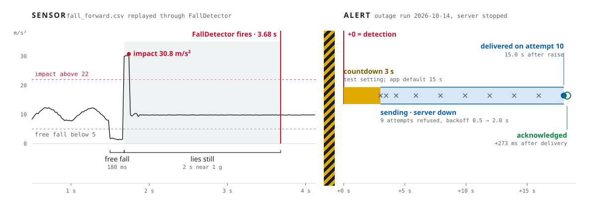
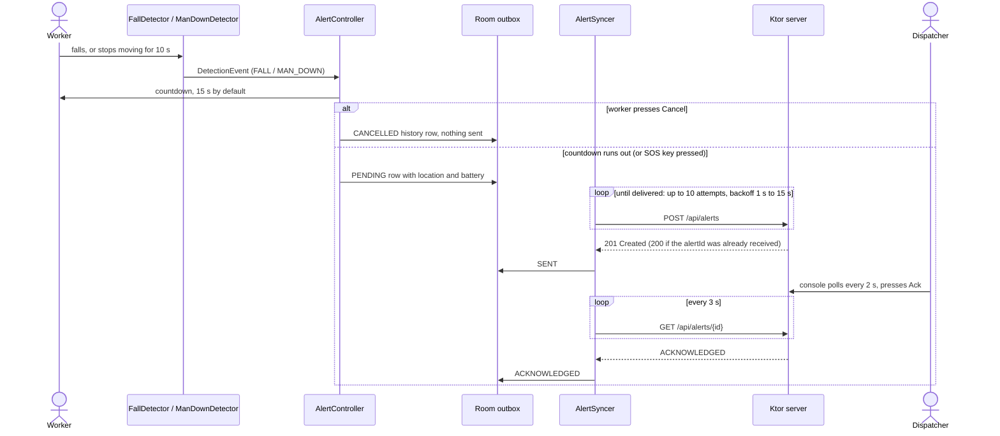
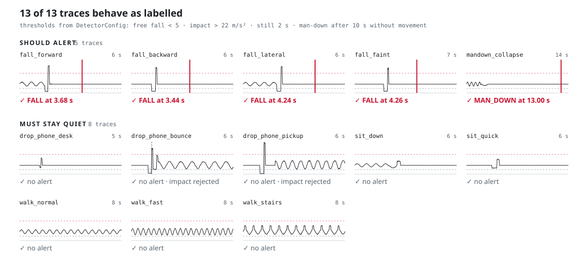
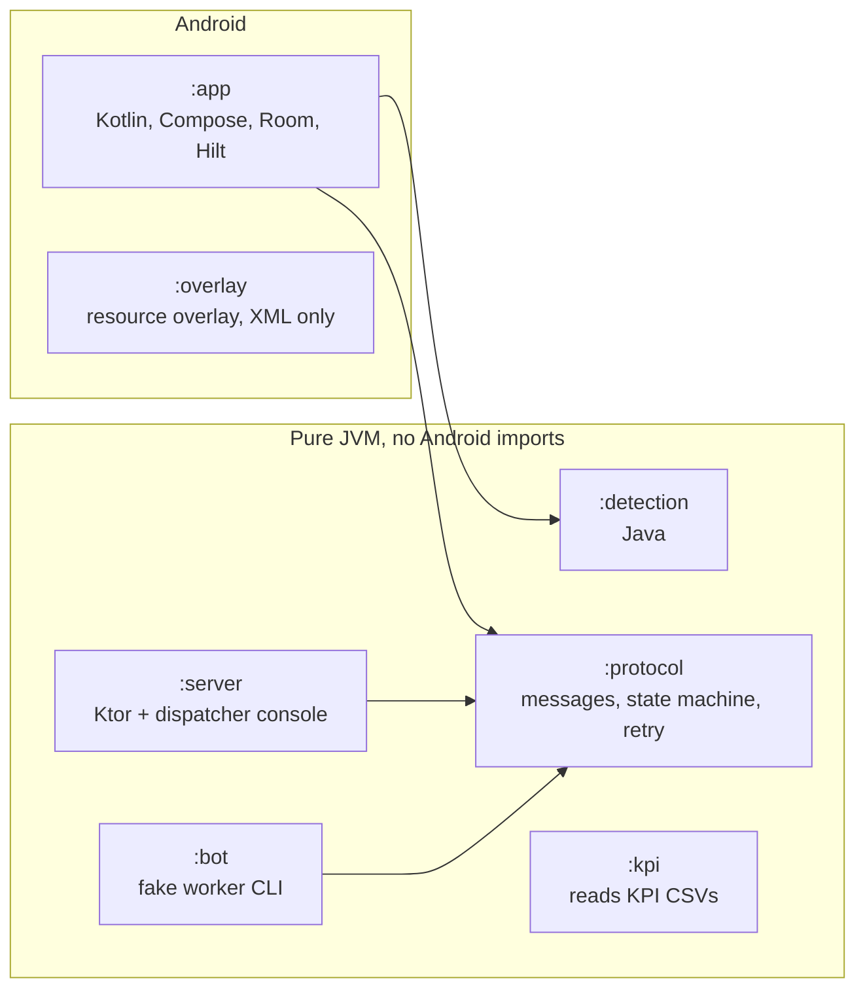

# SafeSignal — Lone Worker Emergency Beacon

[](https://github.com/luqshzeeq3601-art/safesignal/actions/workflows/ci.yml)
[](LICENSE)

An offline-first Android beacon for people who work alone. It watches the accelerometer for a fall or for a worker who stops moving, gives the worker a countdown to cancel, then sends the alert with GPS location and battery level to a dispatcher console. Alerts wait in a Room (SQLite) outbox and are retried until the server confirms delivery, so a network outage delays an alert but does not lose it.

<picture>
  <source media="(prefers-color-scheme: dark)" srcset="docs/images/hero-fall-dark.svg">
  
</picture>

<sub>Left: `fall_forward.csv` replayed through the real `FallDetector`. Right: the alert raised during the server outage in the 2026-10-14 run (`scripts/kpi-run.ps1 -Quick`; data in [`docs/evidence/alert-outage-timeline-2026-10-14.csv`](docs/evidence/alert-outage-timeline-2026-10-14.csv)). Regenerate with `python scripts/render-docs.py`.</sub>

---

## How an alert travels



Every step above is one transition of a pure state machine in `:protocol`. See the [state diagram](ARCHITECTURE.md#alert-state-machine).

---

## Detection

<picture>
  <source media="(prefers-color-scheme: dark)" srcset="docs/images/traces-dark.svg">
  
</picture>

- **Fall:** free fall below 5 m/s², an impact above 22 m/s² within 800 ms, then 2 s lying still near 1 g. A dropped phone that is picked up fails the stillness check.
- **Man-down:** no movement for 10 s.
- The traces are synthetic, generated by `scripts/gen-traces.ps1`. Thresholds are the defaults in `DetectorConfig.java`.

---

## Measured results

From the device-mode run on the emulator, 2026-10-14 ([`docs/evidence/reverification-2026-10-14.txt`](docs/evidence/reverification-2026-10-14.txt)).

| KPI | Target | Measured | Notes |
|---|---|---|---|
| Raise-to-delivery latency | p50 < 5 s, p95 < 15 s | p50 539 ms, p95 548 ms | 20 alerts; the countdown (3 s in this run) is reported separately |
| Delivery success | ≥ 95% within 60 s | 100% (20/20) | 95% on the first attempt; the first alert was raised during a server outage |
| False-alarm cancellation | < 15% | 9.1% (2/22) | 2 scripted cancellations, not real worker data |
| Detector false positives | 0 | 0 of 8 non-fall traces | lab traces above |
| Battery | < 5.0 mAh/h | 1.49 mAh/h | emulator `power_profile.xml` estimate over 10 min, not a hardware measurement |

---

## Architecture



- **SOS key:** scancode 88 is remapped to `KEYCODE_F12` with the wake flag (`aosp/qwerty2.kl`). `MainActivity` keeps the screen on during a shift so the first press raises the alert.
- **Sensors:** accelerometer at about 50 Hz (`SENSOR_DELAY_GAME`). Location comes from `LocationManager` GPS, network and passive listeners, because the AOSP image has no Play services.
- **Outbox:** the Room `alerts` table, indexed on `status` and `raisedAtEpochMs`. `PENDING` rows are retried by `AlertSyncer`. The client-generated `alertId` makes a retried POST safe.
- **Kiosk:** the app is Device Owner and runs in lock-task mode with the keyguard kept.

Detail: [ARCHITECTURE.md](ARCHITECTURE.md) · data shapes: [Data.md](Data.md).

---

## Run it

Requires JDK 17, PowerShell 7 and the Android SDK (API 34) for `:app`. Python 3.10+ is only needed to regenerate the charts.

```powershell
# Unit tests for every module
.\gradlew.bat test

# Android lint
.\gradlew.bat :app:lintDebug

# End-to-end on the JVM: real server outage, bot retries until delivered
.\scripts\e2e-jvm.ps1

# KPI report without a device (battery not measured)
.\scripts\kpi-run.ps1 -Quick

# Redraw docs/images from traces, detector and evidence
python scripts/render-docs.py
```

CI runs the JVM and app unit tests, lint, `e2e-jvm.ps1` and `kpi-run.ps1 -Quick` on every push ([`.github/workflows/ci.yml`](.github/workflows/ci.yml)).

---

## Repository documentation

| Document | Purpose |
|---|---|
| [PRD.md](PRD.md) | Problem, objectives, milestones |
| [ARCHITECTURE.md](ARCHITECTURE.md) | Modules, layers, state machine, key decisions |
| [ARCHITECTURE-ESSENTIALS.md](ARCHITECTURE-ESSENTIALS.md) | The rules to keep on every change |
| [Data.md](Data.md) | Alert JSON, server API, Room table, KPI CSVs |
| [Security.md](Security.md) | Secrets, device admin, permissions |
| [docs/evidence/](docs/evidence/) | Saved output of every milestone check |
| [docs/debugging/](docs/debugging/) | Root-cause write-ups |
| [docs/audits/](docs/audits/) | Quality, security, performance and test audits |

---

## License

MIT. See [LICENSE](LICENSE).
